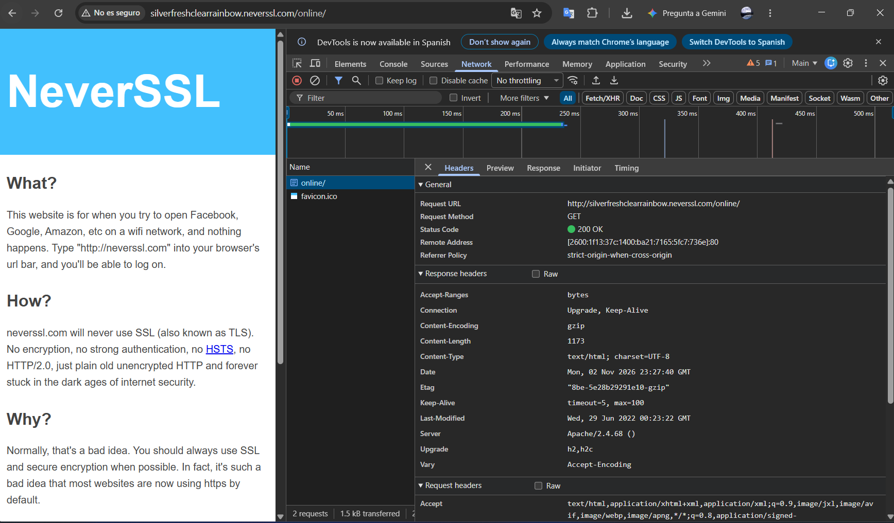
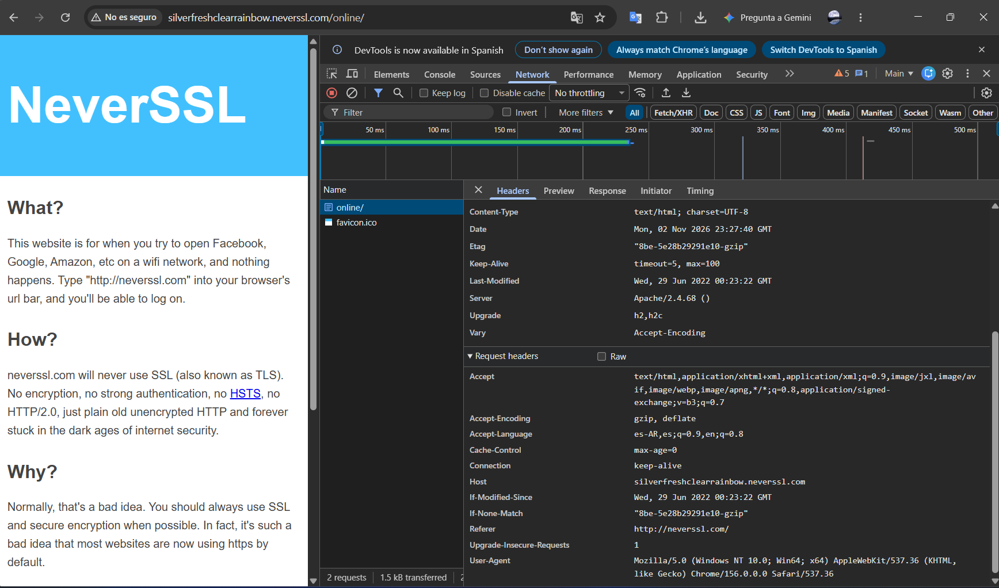

# Informe de Auditoría de Red Wi-Fi Insegura

**Checkpoint:** Seguridad en el aire: cómo sobrevivir a una Wi-Fi pública

**Alumno:** Lucca

**Actividad:** Análisis de tráfico HTTP y recomendaciones de seguridad

**Herramientas:** Navegador web y herramientas de desarrollador (F12)

**Sitio analizado:** http://neverssl.com

## 1. Introducción

El objetivo de esta práctica es identificar los riesgos de seguridad asociados al uso de redes Wi-Fi públicas y analizar cómo se transmite la información mediante el protocolo HTTP.

Para ello, se utiliza el sitio NeverSSL y las herramientas de desarrollador del navegador, que permiten inspeccionar solicitudes de red, encabezados y protocolos de comunicación.

También se analizan las ventajas de HTTPS y las redes privadas virtuales (VPN) como mecanismos de protección.

## 2. Sitio analizado

**Sitio web:** http://neverssl.com

NeverSSL permite realizar pruebas de navegación mediante HTTP sin cifrado HTTPS.

Esta característica facilita el análisis de las solicitudes y permite comprender qué información puede quedar expuesta durante una comunicación insegura.

### Procedimiento de análisis

Se utiliza el navegador web para acceder al sitio y examinar su tráfico mediante las herramientas de desarrollador.

Se selecciona la pestaña **Network (Red)**, se recarga la página y se inspecciona la solicitud HTTP realizada al servidor.

## 3. Evidencia del tráfico HTTP
### Evidencia 1: Solicitud HTTP

### Evidencia 2: Encabezados HTTP

La información que debe verificarse en la solicitud es la siguiente:

| Elemento | Información |
|---|---|
| Sitio solicitado | http://neverssl.com |
| Método HTTP | GET |
| Host | neverssl.com o el subdominio utilizado en la solicitud |
| Protocolo | HTTP sin cifrado TLS |
| URL solicitada | Dirección completa que aparece en Network |
| Headers | Encabezados enviados por el navegador |

El método GET permite solicitar recursos de un servidor web.

Los encabezados HTTP pueden contener información sobre el navegador, formatos aceptados y otros datos necesarios para procesar la solicitud.

**Evidencia 1 — Análisis de la solicitud HTTP**

[PEGAR CAPTURA DE F12 → NETWORK → SOLICITUD HTTP]

## 4. Riesgos encontrados

### 4.1. Intercepción de información (Sniffing)

En una red Wi-Fi pública, un atacante con capacidad de observar el tráfico podría interceptar comunicaciones HTTP y analizar información transmitida sin cifrado.

Entre los datos potencialmente visibles se encuentran el dominio solicitado, la URL, el método GET y determinados encabezados HTTP, como User-Agent.

### 4.2. Ataques Man-in-the-Middle (MITM)

Un atacante podría intentar posicionarse como intermediario entre el usuario y el servidor.

En comunicaciones HTTP, esto podría permitir la lectura y modificación de información transmitida.

### 4.3. Redes falsas (Evil Twin)

Un atacante podría crear una red Wi-Fi con un nombre similar al de una cafetería, universidad o aeropuerto.

Si un usuario se conecta a esa red, el atacante podría intentar supervisar o manipular parte de sus comunicaciones.

### 4.4. Exposición de datos personales

Al utilizar HTTP, la información enviada mediante formularios u otras solicitudes podría quedar expuesta si se transmite sin cifrado.

Por ese motivo, no se recomienda ingresar contraseñas, información bancaria ni datos confidenciales en páginas HTTP.

## 5. Diferencias entre HTTP y HTTPS

| HTTP | HTTPS |
|---|---|
| No cifra el contenido | Utiliza cifrado TLS |
| Permite observar datos transmitidos | Protege el contenido de aplicación |
| Es vulnerable a modificaciones en tránsito | Proporciona integridad de los datos |
| No autentica criptográficamente al servidor | Permite autenticar al servidor mediante certificados |

HTTPS proporciona mayor protección para la información intercambiada entre el navegador y el servidor.

Sin embargo, HTTPS no garantiza que un sitio sea legítimo o esté libre de amenazas.

## 6. ¿Cómo ayuda una VPN?

Una VPN (Red Privada Virtual) establece un **túnel cifrado** entre el dispositivo del usuario y el servidor VPN.

Mediante técnicas de cifrado y encapsulamiento, el tráfico viaja protegido a través de la red local.

### Beneficios de una VPN

**Cifrado:** Dificulta que otros usuarios de la Wi-Fi pública puedan leer el contenido del tráfico transportado por el túnel.

**Túnel seguro:** Encapsula las comunicaciones dentro de una conexión protegida.

**Privacidad:** Reduce la información que puede observar el administrador de la red local, aunque el proveedor VPN todavía puede conocer ciertos metadatos.

**Protección del tráfico:** Ayuda a reducir los riesgos de interceptación dentro de redes no confiables.

Es importante aclarar que una VPN no reemplaza HTTPS. Si se utiliza HTTP, la comunicación puede quedar expuesta después de salir del servidor VPN.

## 7. Mis 3 Reglas de Oro para utilizar redes Wi-Fi públicas

1. **Verificar la red antes de conectarme.** Confirmar que el nombre de la Wi-Fi corresponde al establecimiento y evitar redes desconocidas o sospechosas.

2. **Utilizar HTTPS y una VPN confiable.** Priorizar sitios con conexiones cifradas y utilizar una VPN cuando sea necesario proteger el tráfico frente a observadores de la red local.

3. **Evitar operaciones sensibles en redes desconocidas.** No ingresar contraseñas, realizar operaciones bancarias ni compartir información confidencial mediante conexiones HTTP.

## 8. Conclusión

Esta práctica permite comprender los riesgos asociados al uso de redes Wi-Fi públicas y la importancia de proteger la información durante su transmisión.

El análisis del protocolo HTTP demuestra que las comunicaciones sin cifrado pueden exponer información que sería visible para un atacante con acceso al tráfico.

Se identificaron amenazas como Sniffing, Man-in-the-Middle y Evil Twin, además de medidas de protección basadas en HTTPS y VPN.

Como conclusión, una navegación segura requiere combinar conexiones cifradas, herramientas de protección y hábitos responsables.

**La seguridad de una red no depende solamente de tener una contraseña de acceso, sino de proteger correctamente la información que circula por ella.**
